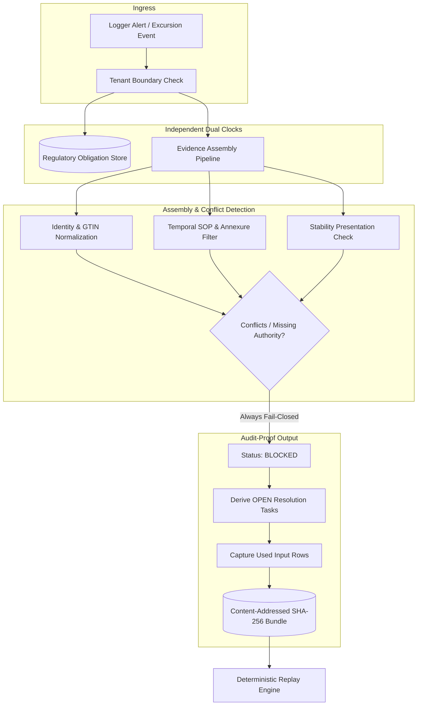

# Kestrel Evidence Adjudication Platform

A production-grade, fail-closed cold-chain excursion review and evidence assembly engine.

Built for pharmaceutical manufacturers and cold-chain logistics providers governed by **21 CFR Part 11**, **EU GMP Annex 11**, and **WHO Technical Report Series No. 961**.

---

## Why This System Exists

When a temperature logger alarms in transit, deciding product disposition (release, quarantine, or destroy) is not simple arithmetic. A Qualified Person (QP) requires verified evidence:
1. Validated product and presentation identity.
2. Verified manufacturer stability study tolerances.
3. The specific SOP revision in force at the receiving site on the date of excursion.
4. Complete cumulative exposure history across the batch lifetime.

This engine compiles the complete evidentiary basis, discovers candidate documents, flags conflicting authorities, and derives **role-assigned resolution tasks**. It operates strictly **fail-closed**: no automated releases are permitted without verified human QA authorization.

---

## System Architecture



---

## Production Guarantees & Invariants

* **Strict Fail-Closed Invariant:** Missing, inverted, or non-finite temperature measurements immediately trigger `BLOCKED` status. They never default to compliant.
* **Separation of Clocks:** The health authority reporting window (e.g. 72h) is registered *before* case assembly. Signing a product disposition never erases or closes a regulatory filing obligation.
* **Tamper-Evident Storage:** Saved case bundles are content-addressed using cryptographic SHA-256 digests. Replay executes against the exact captured source rows.
* **Role-Assigned Tasks:** Every blocker emits a concrete task assigned to a functional role (e.g., `Site QA`, `Document Control`), never an invented named person.
* **JWT Authentication:** Every API endpoint requires a valid Bearer token with tenant and role claims. Tenant is extracted from the token, never from a query parameter.

---

## Quickstart (Try Locally With Synthetic Data)

No private data is required to run the full test suite and CLI workflows:

```bash
# 1. Clone repository and install dependencies
git clone https://github.com/Zulfiqar78634/kestrel-evidence-adjudication.git
cd kestrel-evidence-adjudication
python -m pip install -e ".[dev]"

# 2. Run comprehensive test suite (49 unit & regression tests)
python -m unittest discover -s tests -v

# 3. Generate a synthetic demo workbook
python -m sentinel_review.demo demo.xlsx

# 4. Review a case and generate an immutable evidence bundle
sentinel-review --db demo.sqlite review demo.xlsx --event DEMO-1 --tenant T-DEMO-A --out demo-case.json

# 5. Verify deterministic replay from content-addressed storage
sentinel-review --db demo.sqlite replay BUNDLE_ID --tenant T-DEMO-A

# 6. Verify cross-tenant isolation enforcement (Fails with Exit Code 2)
sentinel-review --db demo.sqlite replay BUNDLE_ID --tenant T-DEMO-B

# 7. Inspect regulatory notification obligations
sentinel-review --db demo.sqlite obligations --tenant T-DEMO-B
```

## Production Deployment (Docker Compose)

```bash
docker compose up --build
# App runs on http://localhost:8000
# Health: curl http://localhost:8000/healthz
# Ready: curl http://localhost:8000/readyz
# Review a case: curl -X POST -H "Authorization: Bearer $TOKEN" http://localhost:8000/v1/cases/EXC-107133
```

---

## Documentation Index

| Mode | Document | Description |
|---|---|---|
| **Overview** | [docs/START-HERE.md](docs/START-HERE.md) | Plain-language introduction, mental models, and quickstart tutorial. |
| **Architecture** | [docs/ARCHITECTURE.md](docs/ARCHITECTURE.md) | SOLID design principles, system layers, and regulatory invariants. |
| **Production** | [docs/PRODUCTION.md](docs/PRODUCTION.md) | Production readiness, deployment, and CI verification. |
| **Decisions** | [docs/adr/0001-blocked-by-default.md](docs/adr/0001-blocked-by-default.md) | Architecture Decision Record: Why all outputs are BLOCKED by default. |
| **Technical Design** | [docs/LLD.md](docs/LLD.md) | Low-level design, schema specifications, and persistence models. |
| **Audit Tasks** | [docs/RESOLUTION-TASKS.md](docs/RESOLUTION-TASKS.md) | Specification of the 14 resolution task templates and completion rules. |
| **Review & Safety** | [docs/REVIEW.md](docs/REVIEW.md) | Google-style engineering review, known limitations, and fixed defects. |
| **Validation** | [docs/VALIDATION.md](docs/VALIDATION.md) | Empirical test execution logs on the 420-case private benchmark extract. |
