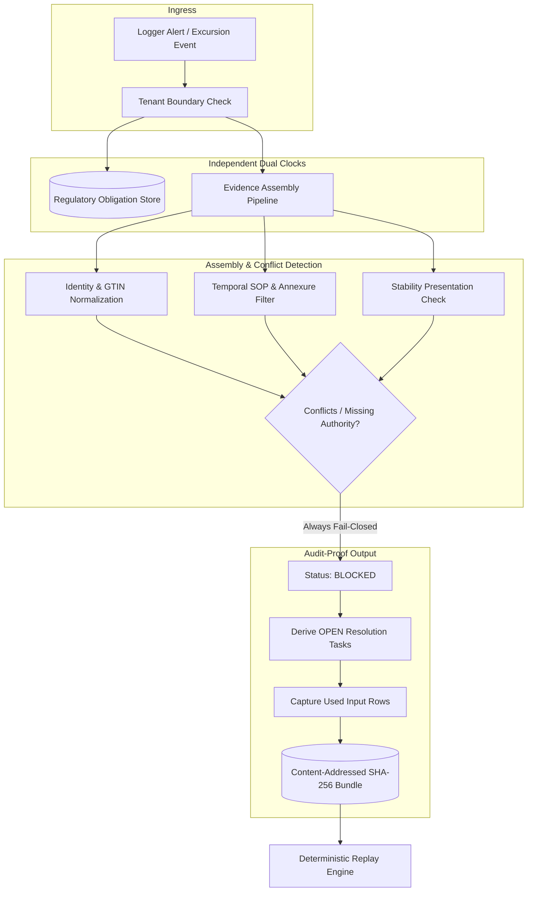

# Kestrel Evidence Adjudication Platform

A production-grade, fail-closed cold-chain excursion review and evidence assembly engine.

Built for pharmaceutical manufacturers and cold-chain logistics providers governed by **21 CFR Part 11**, **EU GMP Annex 11**, and **WHO Technical Report Series No. 961**.

---

## Why This System Exists

When a temperature logger alarms in transit, deciding product disposition (release, quarantine, or destroy) is not simple arithmetic. A Qualified Person (QP) requires verified evidence:
1. Validated product and presentation identity.
2. Verified manufacturer stability study tolerances.
3. The specific SOP revision in force at the receiving site on the date of excursion.
4. Complete cumulative exposure history across the batch lifetime.

This engine compiles the complete evidentiary basis, discovers candidate documents, flags conflicting authorities, and derives **role-assigned resolution tasks**. It operates strictly **fail-closed**: no automated releases are permitted without verified human QA authorization.

---

## System Architecture



---

## Production Guarantees & Invariants

* **Strict Fail-Closed Invariant:** Missing, inverted, or non-finite temperature measurements immediately trigger `BLOCKED` status. They never default to compliant.
* **Separation of Clocks:** The health authority reporting window (e.g. 72h) is registered *before* case assembly. Signing a product disposition never erases or closes a regulatory filing obligation.
* **Tamper-Evident Storage:** Saved case bundles are content-addressed using cryptographic SHA-256 digests. Replay executes against the exact captured source rows.
* **Role-Assigned Tasks:** Every blocker emits a concrete task assigned to a functional role (e.g., `Site QA`, `Document Control`), never an invented named person.
* **JWT Authentication:** Every API endpoint requires a valid Bearer token with tenant and role claims. Tenant is extracted from the token, never from a query parameter.
* **Notification Outbox:** Regulatory notifications are queued in an outbox with retry/backoff, delivered asynchronously, and never block the main flow.
* **Independent Pager:** A separate paging channel fires independently of the primary notification, ensuring critical alerts are never missed.
* **WORM Archive:** Evidence bundles are written to an append-only archive with retention policy enforcement (7 years default).
* **Mock Providers for Local/CI:** All external integrations (telemetry, email, SMS, pager, archive) have mock implementations that work without API keys, enabling full local testing and CI without credentials.
* **Load Testing:** Locust-based load test simulates production-scale traffic on review, replay, and health endpoints.
* **Chaos Engineering:** Network, DB, notification provider, and telemetry failure scenarios verify fail-closed behavior and graceful degradation.

---

## Quickstart (Try Locally With Synthetic Data)

No private data, no API keys, no cloud account required:

```bash
# One-command verification
bash load_test/verify_local.sh

# Or step by step
git clone https://github.com/Zulfiqar78634/kestrel-evidence-adjudication.git
cd kestrel-evidence-adjudication
python -m pip install -e ".[dev]"
python -m unittest discover -s tests -v          # 70+ tests pass
python -m sentinel_review.demo demo.xlsx
sentinel-review --db demo.sqlite review demo.xlsx --event DEMO-1 --tenant T-DEMO-A --out demo-case.json
sentinel-review --db demo.sqlite replay BUNDLE_ID --tenant T-DEMO-A
python -m unittest load_test.chaos -v            # chaos tests pass
```

## Production Deployment (Docker Compose)

```bash
docker compose up --build
# App runs on http://localhost:8000
# Health: curl http://localhost:8000/healthz
# Ready: curl http://localhost:8000/readyz
# Review a case: curl -X POST -H "Authorization: Bearer $TOKEN" http://localhost:8000/v1/cases/EXC-107133
```

## Load Testing (Locust)

```bash
pip install locust
locust -f load_test/locustfile.py --host=http://localhost:8000 --headless -u 10 -r 2 -t 30s
# Simulates 10 concurrent users, 2 users/sec ramp, 30 second duration
```

## Chaos Engineering

```bash
python -m unittest load_test.chaos -v
# Tests: network failure, DB failure, notification provider failure, telemetry failure
# All scenarios verify fail-closed behavior and graceful degradation
```

---

## Documentation Index

| Mode | Document | Description |
|---|---|---|
| **Overview** | [docs/START-HERE.md](docs/START-HERE.md) | Plain-language introduction, mental models, and quickstart tutorial. |
| **Architecture** | [docs/ARCHITECTURE.md](docs/ARCHITECTURE.md) | SOLID design principles, system layers, and regulatory invariants. |
| **Production** | [docs/PRODUCTION.md](docs/PRODUCTION.md) | Production readiness, deployment, and CI verification. |
| **Decisions** | [docs/adr/0001-blocked-by-default.md](docs/adr/0001-blocked-by-default.md) | Architecture Decision Record: Why all outputs are BLOCKED by default. |
| **Technical Design** | [docs/LLD.md](docs/LLD.md) | Low-level design, schema specifications, and persistence models. |
| **Audit Tasks** | [docs/RESOLUTION-TASKS.md](docs/RESOLUTION-TASKS.md) | Specification of the 14 resolution task templates and completion rules. |
| **Review & Safety** | [docs/REVIEW.md](docs/REVIEW.md) | Google-style engineering review, known limitations, and fixed defects. |
| **Validation** | [docs/VALIDATION.md](docs/VALIDATION.md) | Empirical test execution logs on the 420-case private benchmark extract. |
