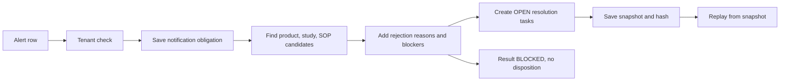

# Kestrel Evidence Adjudication

Evidence-first case-study submission for Kestrel's "The Adjudication Problem". For each excursion alert it finds candidate product, study and SOP records, says exactly why each is or is not usable, and lists what a person must resolve (resolution tasks). It then saves the package with its inputs so it can be replayed. It never releases, destroys or signs product and is not a validated clinical system.

## How one case flows



The obligation is saved before assembly so a later failure cannot erase it. Every result is BLOCKED because source documents, approvals and batch history are not available to this tool.

## Try it locally (no private data needed)
```sh
git clone https://github.com/Zulfiqar78634/kestrel-evidence-adjudication
cd kestrel-evidence-adjudication
python -m pip install -e ".[dev]"
python -m unittest discover -s tests -v          # 36 pass, 1 skipped (needs the private workbook)
python -m sentinel_review.demo demo.xlsx          # builds a SYNTHETIC workbook
sentinel-review --db demo.sqlite review demo.xlsx --event DEMO-1 --tenant T-DEMO-A --out demo-out.json
sentinel-review --db demo.sqlite replay BUNDLE_ID --tenant T-DEMO-A     # BUNDLE_ID is printed in demo-out.json
sentinel-review --db demo.sqlite obligations --tenant T-DEMO-B
```
`make test`, `make demo` and `make check` run the same commands where `make` is installed. On Windows use the `python -m` forms. The demo is invented data: three events, two tenants, a pen and a vial study, and two overlapping SOP revisions.

With the real workbook (kept outside this repo):
```sh
KCCS_WORKBOOK=/private/KCCS_Sentinel_Reference_Data_Pack.xlsx python -m unittest discover -s tests -v
sentinel-review --db run.sqlite review /private/KCCS_Sentinel_Reference_Data_Pack.xlsx --event EXC-107133 --tenant T-KAVERI --out case.json
```
Do not commit `case.json` or SQLite files; they contain real case data.

## How the code is organised

| Module | Role | Depends on |
|---|---|---|
| `sentinel_review/domain.py` | Pure helpers: hashing, parsing, tenant scope | nothing |
| `sentinel_review/ports.py` | Interfaces: `SourceCatalog`, `EvidenceRepository` | domain |
| `sentinel_review/workbook.py` | Adapter: reads the workbook | domain, openpyxl |
| `sentinel_review/tasks.py` | Resolution tasks per blocker | domain |
| `sentinel_review/assembly.py` | Candidate discovery, rejection reasons, blockers | domain, ports, tasks |
| `sentinel_review/storage.py` | Adapter: SQLite bundles and obligations | domain |
| `sentinel_review/service.py` | Use cases: `review`, `replay` | assembly, ports |
| `sentinel_review/cli.py` | Local operator CLI | all of the above |
| `sentinel_review/demo.py` | Builds the synthetic demo workbook | openpyxl |

Service and assembly code depend on the interfaces in `ports.py`, not on SQLite or the workbook, so the unit tests can run them on in-memory data. `kestrel.py` with `tests/test_kernel.py` and `tests/test_integration.py` is an earlier single-file synthetic kernel (v0.1.0), kept for history.

Documents: `docs/POSITION.md` (A), `docs/HLD.md` and `docs/LLD.md` (B), `docs/RESOLUTION-TASKS.md`, `docs/VALIDATION.md` (C), `docs/AI-WORKING-LOG.md` (D), `docs/INTERVIEW.md` (preparation notes).

## Quality gates
```sh
ruff check sentinel_review     # blocking in CI
mypy                           # informational in CI until typed models land (Step 2)
coverage run -m unittest discover -s tests && coverage report
```
Coverage is reported without a pass threshold. Configuration is in `pyproject.toml`.

## What it does not do
No authenticated API or roles, no qualified or dual signing, no source-document verification, no approved identity mapping, no batch or once-only ledger, no calendar or notification delivery, no immutable archive, no way to close a task, no measured scale. See `docs/VALIDATION.md` for what was and was not executed.

## Roadmap

| Step | Work | Status |
|---|---|---|
| 1 | Quality gates (ruff, mypy, coverage) and README | Committed; CI result not observed |
| 2 | Typed domain models in place of plain dictionaries; make mypy blocking | Not started |
| 3 | Resolution tasks, synthetic demo workbook, local-test tooling | Tested locally; CI result not observed |
| 4 | Input validation and structured CLI errors | Not started |
| 5 | Authenticated API with tenant taken from the token; task closure with approved evidence | Not started |
| 6 | Postgres adapter, migrations and shared adapter contract tests | Not started |
| 7 | ADRs, diagrams, runbook; keep docs in step with behaviour | Partly done |
| 8 | Retire or move the legacy single-file kernel | Not started |

Each step is a separate commit, written test-first, and not marked done until its gate has run.

## Verification status
Last executed locally: 37 tests on the new package (all pass with the private workbook; 36 pass and 1 is skipped without it), 420 of 420 events replayed identically, a package build and installed console command ran end to end on the synthetic workbook. Not verified: the remote CI result, ruff and mypy results, a combined run with the legacy tests, and any clinical, security or scale property.
