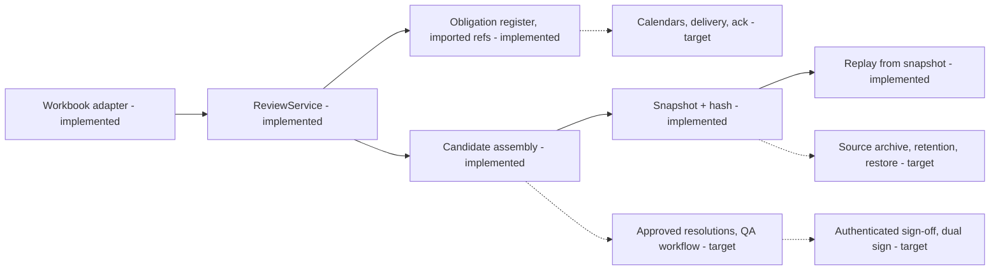

# B1. High-level design

Legend: implemented = offline slice in this repo; target = designed, not built.

## Components and ownership (target)
Admission (platform): authenticate source, validate, persist event and notification assessment atomically with an outbox. Evidence (platform + QA stewards): tenant-owned identity links, source versions, applicability tasks. Policy (QA-owned): versioned rules over approved evidence only. Review: qualified reviewers, evidence-bound approvals, tenant-specific signer rules. Notification (regulatory owner): independent obligation lifecycle. Archive: source bytes, extracted claims, approvals, versions, reassessment lineage. Start as a modular monolith plus a separate notification worker; split further only when isolation or throughput requires it.

## Data flow
Event receipt -> durable record + notification assessment -> scoped evidence queries -> candidate/rejection package -> resolution tasks -> approved facts -> qualified policy -> reviewer disposition -> signed manifest. New evidence creates a linked reassessment; sealed inputs are never edited.

## Tenancy and residency
Derive tenant from authenticated identity, never from a request field. Tenant appears in every key, query, cache, object path, index and dependency edge. Precedent search and any derived index stay tenant-owned (Meridian clause 22; INC-2512). Route EU-only and India-only tenants to matching regional cells, including backups, logs and any inference (workbook 12; 6 of 34 tenants prohibit third-party model APIs). The prototype only proves scoped selection, not isolation.

## Failure contracts (target unless noted)
- Admission store down: do not acknowledge; caller retries with an idempotency key.
- Evidence source unavailable: keep the case and blockers; never infer safety.
- Worker crash: obligations and events are durable; lease expiry resumes work. Implemented partially: obligation row survives an assembly failure (tested).
- Archive write fails: no signature success.
- Notification delivery fails: retry on a stable obligation id and page before the deadline; separate submitted from acknowledged.
- Unknown calendar: raise an urgent task; do not guess business-day arithmetic.
- Late or corrected source data: append a version and reassess dependents.

## Ordering, duplicates, storms
Sources are at-least-once and out of order (workbook 11). Idempotent admission on source id plus payload hash; same id with different payload is a conflict. Physical-duplicate detection needs shipment, leg, logger and time evidence, not historical text. Reserve worker capacity for regulatory tasks, apply per-tenant limits and fair scheduling, and group related alerts for review without deleting per-product obligations (INC-2502).

## Scale and cost
Separate telemetry ingestion (about 10 million readings a day) from excursion cases (11,400 a month; burst of 1,912 in 38 minutes). Size on bursts and retention, not averages. Storage is parameterized as readings per day x bytes x retention x replication; for example 100 bytes per reading over 7 years is about 2.6 TB before replicas and indexes. These are assumptions to validate, not measurements.

## Release and change control
Rule or source diff -> tests -> historical comparison with explained differences -> QA approval -> single-tenant canary -> promotion. Rollback never rewrites signed decisions (brief p.6; INC-2411). Provider deprecation notices (30 days to 12 months in workbook 13) must fit a replacement qualification plan.

## Alternatives rejected
All-model adjudication (brief p.5 pilot), a document-QA tool alone (cannot join to shipment, batch or contract), a full nine-system rewrite inside the exercise, and a graph database as a first step. SQLite is used here only for offline reproducibility.
