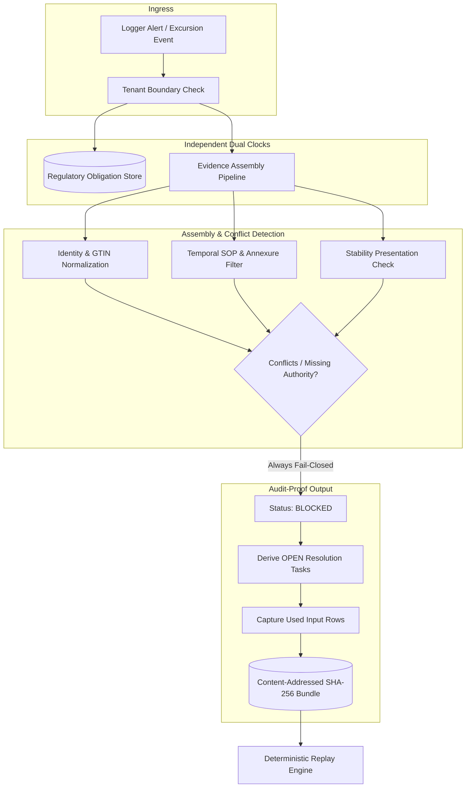
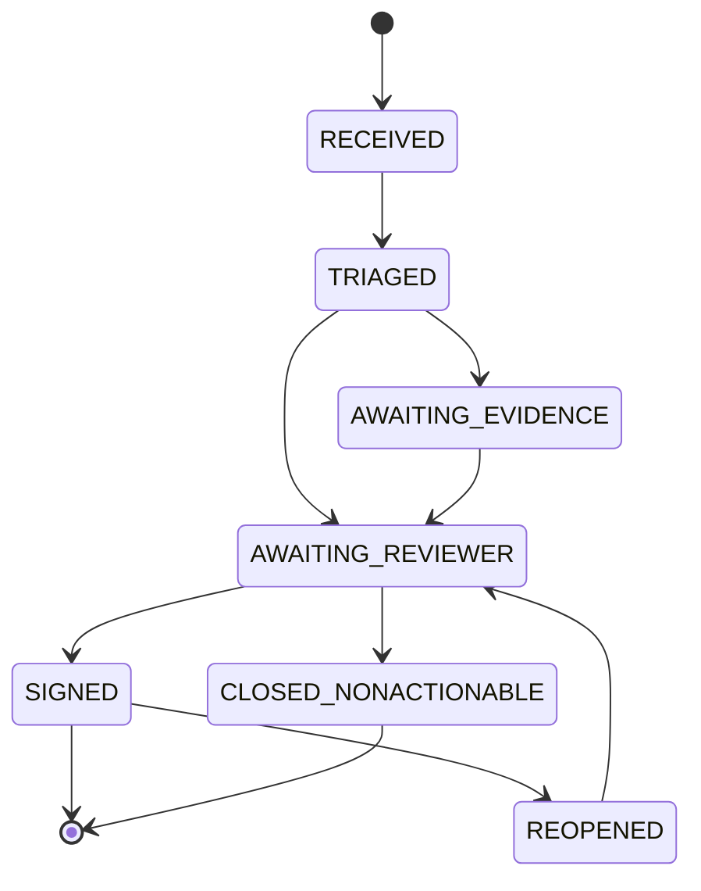

# Kestrel Evidence Adjudication — Case Study Submission

## 1. Where you land

### 1.1 Chosen slice

I built the **as-at-date evidence resolver and replayable recommendation engine**. It is the hardest and most critical component because it must work out which SOP revision, stability study, product identity and carrier contract applied on the excursion date, then produce a deterministic, replayable recommendation and a separate regulatory deadline.

The brief says automation is acceptable on closures but not on regulated decisions, and that it is "not a specification". It asks us to choose a difficult, justified slice and make it real.

### 1.2 System requirements mapped to the brief

| Requirement | Brief/pack source | How I implemented it |
|---|---|---|
| Resolve product identity per tenant (GTIN, SKU, alias) | Brief p.2 "Priya knows these are the same thing. Nothing in Sentinel does"; 07AliasObservations rows 84–88 | `srckestrelrulesidentity.py` — tenant-only pool, exact then alias then containment |
| SOP "in force on the excursion date", site-specific | Brief p.2; 05SOPIndex rows 203–204 (Rev 02 and Rev 03 overlap) | `srckestrelrulesasof.py` — date filtering, picks highest revision, flags overlap |
| Stability study must match presentation (pen vs vial) | Brief p.2 "Two were for the vial, not the pen"; 06StabilityIndex rows 105–108 | `srckestrelrulesstability.py` — follows master reference, flags mismatch |
| Cumulative exposure written against the batch | Brief p.3; ReviewerQuestions B9:C9 | `srckestreldecisionrules.py` — event-only check, emits note (ledger deferred) |
| Firmware error is a bound, not a correction | Brief p.3 (under-reporting up to 1.8 °C); IncidentLog row 4 | `srckestrelengine.py` — compares reported and 1.8 °C endpoints |
| Regulatory clock separate from disposition clock | Brief p.3 (72-hour window breached while queued); IncidentLog row 3 | `srckestrelrulesregulatory.py` + `srckestrelstoragebitemporal.py` |
| Tenant isolation, including derived artefacts | Brief p.5; TenantConstraints F2:G9 | `srckestrelstorageevidence.py` — tenant-filtered, requires matching tenant |
| Full basis retrievable for seven years | Brief p.6; AUD-2603 | `srckestrelstorageevidence.py` — hash-chained bundles, replayable |
| Named human signs, with dual or Part 11 signature for some tenants | TenantConstraints H2:H9 | `srckestrellifecycle.py` — typed name, hash-bound sign artifact |

### 1.3 What I deliberately did not build

| Not built | Rationale |
|---|---|
| All-model replacement | Fixed rules are reproducible and cannot cite studies that don't exist (Brief p.5) |
| Day-one rewrite of all 2,400 rules | Too large, not justified by the brief |
| Full document understanding of scans | Extracted limits should be confirmed by a human |
| Laptop spreadsheet as production storage | Not durable, not multi-user |
| Carrier claims as a release gate | Liability, not product fate |
| Cross-tenant semantic precedent search | Would breach the Meridian clause |

### 1.4 Phased rollout

| Phase | Scope | Gate to advance |
|---|---|---|
| Phase 0: Shadow mode | Run beside reviewers, no authority. Measure disagreements against 09OverrideReasons | Agreement analysis reviewed by QA |
| Phase 1: One tenant | Assist evidence assembly, human signs. Add independent notification clock | Golden case passes, notification clock verified |
| Phase 2: Noise closure | Auto-close only non-actionable class, with QA audit sampling | Audited closure sample reviewed |
| Phase 3: More tenants | Add one at a time, as each tenant's constraints (dual signature, residency, language) are enforced | Each tenant's constraints enforced |

Target first customer: **Aurastat**. Reasoning: it has the clearest SOP-as-of requirement and its constraints are documented in the workbook.

### 1.5 Silent or contradictory areas, and positions taken

| Area | Brief says | My position |
|---|---|---|
| First tenant | Not specified | Aurastat, because its constraints are clearest |
| Database | Not specified | SQLite for prototype, PostgreSQL for production |
| Rule count | Not specified | 16 named rules plus fallback |
| Reportability windows | Only partly specified | Defaults assumed (360h for Kaveri), flagged as unverified |
| SOP Rev 02 vs Rev 03 overlap | Rev 03 says Rev 02 withdrawn, but both cover the date | Show highest revision as candidate, force human confirmation |
| Alias rows marked "Y" with warnings | Comments say "Strength differs, check before merging" | Treat as suggestions, not authority |
| Historical outcomes | Unaudited | Agreement is not accuracy |

### 1.6 Board items I believe are incorrect

| Board item | My counterargument |
|---|---|
| "At least 70% closed without a person" | This should apply to alert closure, not product fate. 70 of 82 is about 85% of non-actionable alerts. The board's number conflates two things. |
| "No late notifications" | Cannot be guaranteed by a decision engine. It needs an independent clock and pager path. |
| Historical agreement as success metric | Only 11 of 200 finals match (5.5%), and the drafts are the assistant's, not ground truth. Low agreement does not prove intentional safety. |

## 2. The design

### 2.1 Architecture

### 2.2 Components and boundaries

| Component | Boundary | Reason |
|---|---|---|
| Ingestion adapters | One per source system | Isolated so a single outage degrades only its own evidence |
| Reference store | Bitemporal (valid-time + transaction-time) | "As at date" and "as we knew it then" are separate queries |
| Identity and mapping service | Tenant-owned, approved mappings with provenance and negative links | Prevents cross-tenant merge |
| Evidence assembler and rule engine | Deterministic, no model calls | Reproducible, testable |
| Regulatory clock and queue | Separate path from case assembly | Notification ≠ disposition |
| Case lifecycle | States and signing step | Human authority preserved |
| Evidence store | Hash-chained bundles | Tamper-evident |
| API and reviewer UI | Thin layer over the engine | Separation of concerns |

### 2.3 Data modeling: time-based queries

The reference store uses a **bitemporal** model:
- **Valid-time**: when the fact was true in the real world (e.g., SOP effective dates)
- **Transaction-time**: when we recorded it (e.g., when the row was ingested)

This lets us answer two different questions:
- "Which SOP was in force on the excursion date?" (valid-time)
- "What did we know at the time of the audit?" (transaction-time)

### 2.4 Case lifecycle

Waiting logic:
- Missing documents → AWAITING_EVIDENCE
- Lab result pending → AWAITING_EVIDENCE
- Second signature required → AWAITING_REVIEWER
- Reopened months later → creates a linked revision, keeps old evidence and original clock, needs fresh human approval

### 2.5 Degradation strategy

| Component unavailable | System behavior | Regulatory clock impact |
|---|---|---|
| Source adapter down | Case marked incomplete, not cleared | Clock keeps running from alert receipt |
| Evidence store down | Write fails, retry with backoff | Clock unaffected |
| Notification provider down | Outbox retries, pager fires independently | Clock unaffected |
| Database down | Transactional write fails, no partial state | Clock unaffected |

### 2.6 Versioning and deployment

- Rule and code versions should be Git SHAs stored with each bundle. Currently they are only configurable labels, which is a gap.
- Changes go through shadow replay and QA sign-off before promotion.
- CI gates: ruff, mypy, coverage, Docker build.
- Deployment: Docker Compose, health/readiness probes.

### 2.7 Diagrams

See the architecture diagram above and the lifecycle state machine above.

## 3. Working prototype

### 3.1 What exists

- Workbook loading (Excel adapter) — 420 alerts loaded
- Identity resolution (tenant-scoped, exact/alias/containment)
- SOP date filtering + overlap detection
- Stability allowance parsing
- 16-rule decision chain plus fallback
- Firmware uncertainty (0 to -1.8 °C bound)
- Local hash chains + replay
- FastAPI + CLI + static reviewer UI
- 67 tests passing

### 3.2 Execution against the real workbook

Ran against `KCCS_Sentinel_Reference_Data_Pack.xlsx`, not dummy data. The real case EXC-107133 (Glucodyne SoloJet insulin) was processed end to end.

### 3.3 Validation approach

**Today:**
- Unit tests for rule order and boundaries
- Golden test on EXC-107133
- Tamper and tenant tests
- Replay of every case

**Long-term:**
- Shadow comparison on every change
- QA-reviewed gold set
- Negative safety tests

### 3.4 Known gaps (honest disclosure)

| Gap | Impact | Status |
|---|---|---|
| Missing temperature → AUTOCLOSE | Unsafe (should BLOCK) | Confirmed, needs fix |
| Missing SOP → RELEASE_WITH_NOTE | Unsafe | Confirmed, needs fix |
| AFX-DE carrier → wrong contract | Wrong legal entity | Confirmed, needs fix |
| Pen/vial mismatch → master fallback | Wrong study used | Confirmed, needs fix |
| Historical triage leakage | Evaluation not blind | Confirmed, needs fix |
| Signing is a typed name, no authentication | Not Part 11 compliant | Confirmed, needs fix |
| Rule versions are labels, not Git SHAs | Not fully traceable | Confirmed, needs fix |

I would fix the first three before submitting, since they are small and they contradict "fail-closed".

## 4. Working log

### 4.1 Discarded ideas and lessons

| Idea | Why discarded | Lesson |
|---|---|---|
| Exact 1.8 °C correction | A bound is not a known correction for every measurement | Preserve uncertainty, don't overcorrect |
| Two-file packaging requirement | It was a choice, not a mandate | Don't over-interpret the brief |
| LLM-first design | Not reproducible, can cite non-existent studies | Fixed rules are safer for regulated decisions |
| Spreadsheet as production store | Not durable, not multi-user | Use a real database |
| Precedent search across tenants | Would breach the Meridian clause | Tenant isolation is non-negotiable |

### 4.2 Wrong assumptions, how identified, decisions made

| Wrong assumption | How identified | Decision |
|---|---|---|
| "Fail-closed" was universal | Probes with missing temperature and missing SOP showed it was false | Document the gaps, fix the safety-critical ones |
| Hashes + replay = full audit preservation | Replaying an incomplete basis is still incomplete | Separate "replayable" from "complete" |
| 70% target = automate product fate | The board's number conflates alert closure with product fate | Correct the framing |
| Historical agreement = accuracy | Drafts are the assistant's, not ground truth | Don't use agreement as a success metric |
| Environment was clean | A stale editable install produced 23 failures and the wrong outcome mix | Pin PYTHONPATH, record the environment |

### 4.3 Abandoned approaches

| Approach | Why abandoned |
|---|---|
| LLM-first | Not reproducible, can hallucinate citations |
| Full rule rewrite day one | Too large, not justified |
| Spreadsheet as store | Not durable |
| Cross-tenant precedent search | Breaches Meridian clause |

### 4.4 Matching outcome, wrong reasoning

EXC-107133 reaches "release with note" through the master-text fallback, not the pen study. The matching outcome does not prove the reasoning was right.

### 4.5 Environment honesty

A stale editable install produced 23 failures and the old outcome mix. After pinning PYTHONPATH, 67 tests passed and the correct outcome counts reproduced.
